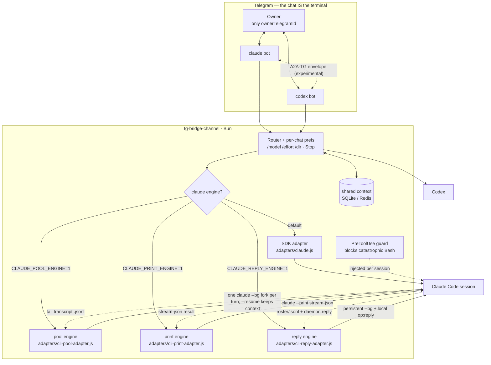

<div align="center">

# tg-bridge-channel

**Self-hosted Telegram bridge for AI coding agents — the chat IS the terminal.**

*Drive Claude Code / Codex from a Telegram chat through SDK or local CLI engines, with the A2A-TG envelope protocol for multi-agent collaboration in group chats.*

[](LICENSE)
[](https://bun.sh)
[](https://telegram.org/)

**English** | [简体中文](README_CN.md)

</div>

> **Status:** stable · low-frequency maintenance · last verified 2026-10. The local CLI engines are coupled to Claude Code internals and had their contract fixtures last re-run against Claude Code 2.1.229 (2026-08-13); newer Claude Code releases may need a fix.

---

## What it is

`tg-bridge-channel` runs AI coding agents as Telegram bots. Each bot is a full agent session you talk to from your phone or desktop — the chat *is* the terminal. It supports three modes:

- **Single-agent control** — one Claude Code / Codex session per bot, driven over Telegram.
- **Parallel sessions** — N independent bots in one group, each its own session, with shared context (SQLite/Redis).
- **Heterogeneous multi-agent collaboration** _(experimental, disabled by default — set `a2aEnabled` to opt in)_ — Claude and Codex bots talking to each other in a group via the A2A-TG envelope protocol, with generation-counted loop suppression.

The **primary, battle-tested path** is single-agent private-chat control of Claude Code via the reply engine below (the pool engine held that role until June 2026 and is kept as the rollback path). Parallel sessions and A2A collaboration work but are experimental; the `local-agent` executor is a compatibility layer that sees far less real-world use. The `gemini` backend is retired for personal accounts — see the note below.

> **Codex** support assumes you have your own Codex subscription and CLI login. The author no longer runs Codex day-to-day, so that path is exercised less often than Claude Code.
>
> **Do not use the `gemini` backend.** It reuses the Gemini CLI's own OAuth credentials to reach Google's internal Code Assist endpoint, which Google's terms explicitly prohibit and say may get your account suspended. Google also retired the personal-account `gemini` CLI on 2026-06-18, so the backend can no longer authenticate. The `backends.gemini.*` keys remain only so old configs parse; to reach Gemini models from third-party software, use a Vertex AI or Google AI Studio API key.

## Should you use this?

Snapshot as of 2026-10. The official features move fast, so check their docs for current behavior.

- **You just want to reach your local Claude Code from your phone.** Use the official [Remote Control](https://code.claude.com/docs/en/remote-control): the Claude app or claude.ai/code drives a session running on your machine, and server mode (`claude remote-control`) can host many concurrent sessions. It needs a Pro, Max, Team, or Enterprise login. The author's own Claude Code bots moved to it in September 2026.
- **You want Telegram itself as the chat window, for one session.** Claude Code's official [Channels](https://code.claude.com/docs/en/channels) include a Telegram plugin (research preview) that pushes your messages into an already-running session, with a pairing-based sender allowlist.
- **You want several backends (Claude Code, Codex, Agy, Kimi) behind Telegram bots.** The sister repo [telegram-ai-bridge](https://github.com/AliceLJY/telegram-ai-bridge) is the broader multi-backend bridge.
- **This repo fits the case left over:** a self-hosted Telegram bridge where each chat owns a persistent, subscription-billed Claude Code background session (also reachable from Remote Control), several bots can run side by side, and you accept that the local CLI engines couple to Claude Code internals and may need a fix after an upgrade.

## Architecture



## Engine layer

The `claude` backend ships four engine implementations. Environment-variable priority is reply → print → pool → SDK:

| Mode | Implementation | How it works | Status |
|---|---|---|---|
| default | `adapters/claude.js` | Programmatic adapter built on the [Claude Agent SDK](https://docs.anthropic.com/en/docs/agents-and-tools/claude-code/agent-sdk). | Fallback / API-billed path |
| `CLAUDE_POOL_ENGINE=1` | `adapters/cli-pool-adapter.js` | Per-**turn** `claude --bg [--resume]` workers; output is tailed from the forked transcript. | Superseded by reply; kept as rollback path |
| `CLAUDE_PRINT_ENGINE=1` | `adapters/cli-print-adapter.js` | `claude --print --output-format stream-json [--resume]`; no daemon reply socket. | Superseded by reply; headless, so no remote control |
| `CLAUDE_REPLY_ENGINE=1` | `adapters/cli-reply-adapter.js` | Persistent `claude --bg` worker plus an authenticated local daemon `op:reply`. | **Primary owner-used CLI path** since June 2026; highest upgrade coupling |

### Why three CLI engines, and why reply won

Each earlier engine solved half the problem:

| Engine | One session per chat? | Reachable by Claude's remote control? | Blocker |
|---|---|---|---|
| pool | No — `--bg --resume` forks a **new session id every turn** | Yes (worker has a PTY) | Every turn leaves another `tg-turn-*` transcript behind |
| print | Yes — `--print --resume` appends in place | No — headless, no TTY | Never enters the daemon's remote-control roster |
| **reply** | Yes | Yes | — |

Claude's remote control needs a TTY plus a resident process, so "don't fork" and "stay reachable from the phone app" were mutually exclusive until the reply engine.

**The reply engine** keeps **one persistent `claude --bg` worker per chat**. The first message spawns it; every later message is delivered into that same session through an authenticated local daemon `op:reply`, so no fork occurs and only one transcript file exists per chat. If the daemon has idle-reclaimed the worker (or the bridge restarted), the next message revives the session with `--bg --resume <session-id>` — that path *does* fork once, but only after an idle gap, not on every turn. Output is read by tailing the same transcript from a recorded offset.

**The pool engine** (previous generation, still the rollback path — and the reply engine reuses its `buildTurnArgs` / transcript tailing / roster helpers) spawns one short-lived `claude --bg` worker **per turn**: each inbound Telegram message launches `claude --bg [--resume <session-id>] "<prompt>"`, which forks a new session inheriting the full conversation history, streams the reply back by tailing the forked session's local transcript file, and stops the worker when the turn completes. The bridge persists the forked session id per chat and resumes it on the next message, so the conversation stays continuous across turns. In all engines, per-chat `/model`, `/effort` and `/dir` preferences plus the bridge's system-prompt scaffold are passed to every spawn as plain CLI flags.

Two practical caveats:

- **Quota grows with conversation length — fork-per-turn (pool) only.** Every turn re-forks the full history, so very long conversations consume subscription usage superlinearly. Start a fresh session (`/new`) when switching topics. The reply engine does not re-send history per turn and is not affected.
- **Silence isn't a hang, and a timeout doesn't kill the task — all CLI engines.** When a long-running task goes quiet for more than `CLI_POOL_HEARTBEAT_MS` (default 3 min), the bridge keeps emitting a "still running" heartbeat instead of declaring failure; only when the turn's total duration exceeds `CLI_POOL_HARD_LIMIT_MS` (default 60 min) does it report a hard timeout — and even then it deliberately leaves the worker running, so its output keeps landing in the session transcript and your next message inherits everything written in the meantime. Normal completion and the Stop button still stop the worker immediately.

Reply-specific tunables: `CLI_REPLY_ROSTER_WAIT_MS` (default 30 s) is how long a revived session waits for the daemon to register the new session id — large conversations must load their full history before that id appears, and a value that is too low makes the bridge silently fall back to a *new* session and lose context. `CLI_REPLY_ECHO_GRACE_MS` (default 90 s) bounds the watchdog for an `op:reply` that was accepted but never produced output.

The backend name stays `claude` in all four modes, so all orchestration (`backendName === "claude"` checks for approval / labels / A2A / cron) is unchanged. Switching engines is a per-process environment variable; rolling back is removing it.

> All three CLI engines invoke documented Claude CLI commands, but reply discovery and completion detection also depend on **observed local implementation contracts**: the `backgrounded · <short-id>` stdout line, `~/.claude/daemon/roster.json`, `~/.claude/projects/<encoded-cwd>/<session-id>.jsonl`, user/assistant record shapes, and either visible-text `end_turn` or `system.turn_duration`. The reply engine additionally depends on the daemon's `control.sock`, its `control.key` authentication, and the `op:reply` protocol itself. None of these is a stable public API. A Claude Code upgrade can therefore break the bridge even when `claude --bg` itself still exists — which is exactly why pool and print are kept rather than deleted.

> An earlier interactive channel-plugin engine (`CLAUDE_CHANNEL_ENGINE=1`) used a local Model Context Protocol server modeled on Claude Code's built-in fakechat channel. It was removed in May 2026 in favor of the Agent View based pool engine; see git history before May 2026 for the channel-plugin engine implementation.

### Claude Code compatibility boundary

| Engine | Documented surface used | Observed / internal contract also used | Upgrade posture |
|---|---|---|---|
| SDK | Published Agent SDK event stream | Local transcripts are consulted for session discovery and resume-noise repair | SDK version pin and regression tests |
| print | `--print`, `--resume`, `--output-format stream-json`, `--settings` | Exact stream-json message/result shapes and local persisted sessions | Synthetic event/result fixtures; no direct roster/socket contract |
| pool | `--bg`, `--resume`, `claude stop`, `--settings` | Background stdout short ID, daemon roster schema, transcript path/records, two turn-end forms | Synthetic roster/transcript fixtures plus optional live startup self-check |
| reply | The same background CLI commands | Everything in pool, plus `control.sock`, a non-empty `control.key` file, and the daemon `op:reply` protocol | In daily use, but the widest internal surface here — expect breakage when daemon internals change, and keep pool/print as fallbacks |

The bridge does **not** bundle or auto-update Claude Code. CLI engines resolve `CLAUDE_CLI_PATH`, defaulting to `~/.local/bin/claude`, so the operator controls the installed version.

The synthetic local-contract fixtures dated 2026-07-17 were re-run against Claude Code **2.1.229 on 2026-08-13**; that version was also npm's `latest` at release-preparation time. This confirms that the required CLI help surfaces were present and the fixtures still matched the parser. It is not a promise that every future Claude Code release will work.

`/doctor` performs a non-invasive structural check for the selected engine. It checks required flags, roster shape, transcript-directory presence, and—only for reply mode—whether `control.key` is a non-empty regular file; it never reads or prints the key. For enabled CLI engines, the delayed startup self-check is the live end-to-end check (`spawn → roster/stream → transcript/result → stop`). It consumes a small Claude turn and can be disabled with `POOL_SELF_CHECK=0`.

## Quick start

Claude Code is installed separately from this package. For a Claude CLI engine, install a current Claude Code release, verify it with `claude --version`, and check the compatibility boundary above before upgrading an existing bridge.

```bash
# 1. create a bot: in Telegram, open @BotFather, send /newbot, copy the token it returns
#    you also need your own numeric Telegram user ID for ownerTelegramId

# 2. install dependencies
bun install

# 3. configure
cp config.example.json config.json
# edit config.json: set ownerTelegramId and backends.claude.telegramBotToken

# 4. run with the reply engine (recommended)
CLAUDE_REPLY_ENGINE=1 bun run start --backend claude --config config.json
```

The reply engine keeps one subscription-billed background session per chat, reachable from Claude's Remote Control. Without an engine flag the bridge uses the default SDK engine:

```bash
bun run start --backend claude --config config.json
```

If the daemon's `op:reply` protocol breaks after a Claude Code upgrade, fall back to the pool engine — same billing path, at the cost of one forked transcript per turn:

```bash
CLAUDE_POOL_ENGINE=1 bun run start --backend claude --config config.json
```

## Multi-instance

Each bot instance uses its own config file (`config.json`, `config-2.json`, …) with a distinct bot token and sessions database. Launch agent templates for always-on operation live in `launchd/`.

Naming note: this repo started as a fork of [telegram-ai-bridge](https://github.com/AliceLJY/telegram-ai-bridge), and the launchd labels (`com.telegram-ai-bridge[-<instance>]`), log directory (`~/Library/Logs/telegram-ai-bridge/`), and Docker example names still carry that name. They were kept so existing installs are not orphaned. The `Dockerfile` and `docker-compose.example.yml` are a starting point only; the author ran the bridge under launchd, not Docker.

## Configuration

See `config.example.json` for the full schema. Key fields:

- `ownerTelegramId` — only this user can drive the bot.
- `backends.<claude|codex|gemini>.telegramBotToken` — bot token per backend.
- `sharedContextBackend` — `sqlite` or `redis` for cross-bot shared memory.
- `outputRelayTrustedChatIds` — group chats allowed to receive generated file and image attachments. Empty by default; even listed groups require the owner to trigger the turn.
- `historyBots` — backend → primary bot username, e.g. `{ "claude": "@your_claude_bot" }`. Secondary bots (started without `BRIDGE_OWNER=true`) hide `/sessions` and `/resume` and use this to tell the user which bot holds the history; unset, they just say "another bot".
- `a2aEnabled` / `a2aPorts` — enable A2A-TG inter-bot messaging.

## Security

Automatic file and image attachments are enabled for owner-triggered private chats. Group attachments are disabled unless the group ID is listed in `outputRelayTrustedChatIds`, and bot-triggered Discuss turns never send attachments. Every detected file path—whether reported by a tool event or found in model text—must resolve to a regular, non-hidden file inside that turn's working directory. Common credential/config/log names, symlink escapes, the inbound upload directory, unsupported types, and files over 20 MB are rejected before reading. In-memory images keep the existing 10 MB limit.

The `claude --bg` engine runs with `--permission-mode bypassPermissions`, so the bot never stalls on permission prompts. To stop that from meaning "the bot will run anything", every `--bg` worker is launched with an injected `PreToolUse` hook (`scripts/guard-destructive-bash.sh`) that hard-blocks a small set of catastrophic, irreversible Bash commands: recursive deletion of `/`, `~`, `$HOME` or a top-level system directory; `mkfs`; `dd` onto a block device; redirecting onto a block device; fork bombs; and `shred` of a device. Everyday commands — including `rm -rf node_modules` — pass untouched.

The hook is injected per session via `--settings` (inline JSON), so it never touches your own `~/.claude/settings.json`. Set `CLI_POOL_DESTRUCTIVE_GUARD=0` to disable it (not recommended for public-facing deployments).

This is a hand brake, not a sandbox: the blocklist only catches straightforward forms and can be bypassed by obfuscated commands (`base64 -d | sh`, variable splicing, spawning a subprocess). For real isolation, run the bot in a container, under a restricted account, or with a constrained working directory.

## A2A-TG protocol

The inter-bot envelope protocol is specified in [docs/a2a-tg-v1.md](docs/a2a-tg-v1.md). It is inspired by — but not compatible with — the official [A2A protocol](https://a2a-protocol.org); it adds generation-based loop suppression and chat-scoped idempotency for the IM scenario.

## Tests

```bash
bun test
bun run check:claude-contract
```

## Ecosystem

- [telegram-ai-bridge](https://github.com/AliceLJY/telegram-ai-bridge) — original Telegram bridge using A2A-TG protocol
- [wechat-ai-bridge](https://github.com/AliceLJY/wechat-ai-bridge) — same idea on WeChat
- [recallnest](https://github.com/AliceLJY/recallnest) — one shared memory layer for any MCP client

## License

MIT — see [LICENSE](LICENSE).
